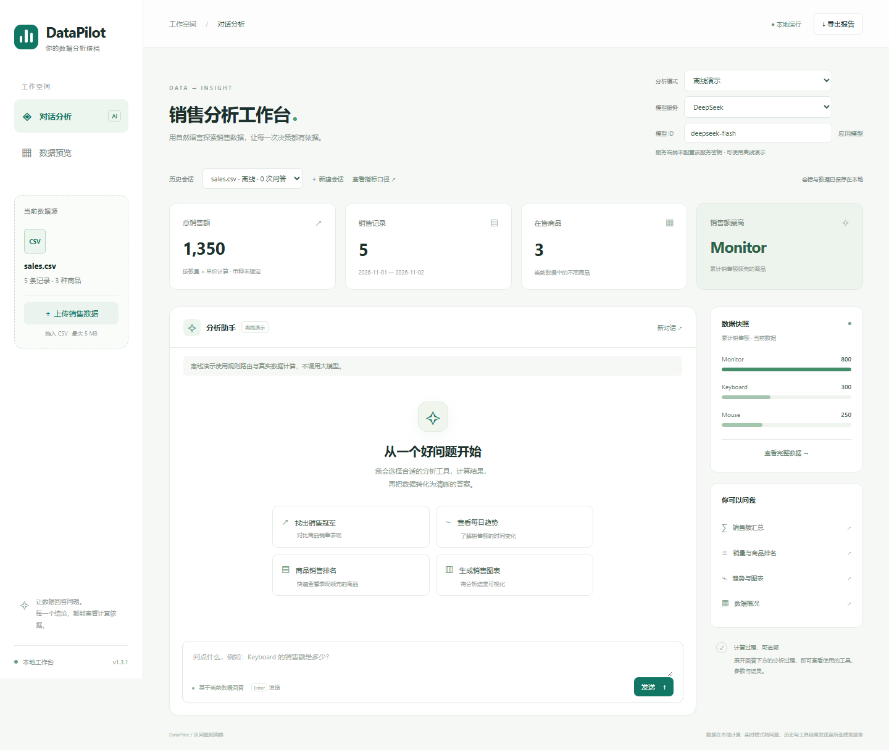

# DataPilot

**上传销售 CSV，用自然语言得到可核对的分析结果。**

DataPilot 是一个用 Python 构建的本地销售数据分析 Agent。问销量、查排名、对比日期区间，或生成趋势图；展开分析过程，可以查看工具参数、计算结果，以及 SQL 查询的语句和结果表格。

[快速启动](#快速运行) · [体验三个案例](#三个上手案例) · [最新版本](https://github.com/lihuipenf/DataPilot/releases/latest) · [安全报告](SECURITY.md) · [English](README_EN.md)

当前版本 **v1.3.1** · Python 3.12 · MIT。完整文档入口见 [文档导航](docs/README.md)，发布变化见 [v1.3.1 说明](docs/releases/v1.3.1.md)。

- **先体验，再接模型**：内置无需 API Key 的离线规则演示；实时模式支持 DeepSeek、OpenAI/Codex、Claude 和 OpenAI 兼容服务。
- **回答附带查询依据**：11 个参数校验工具、版本化指标口径和受限只读 SQL，帮助核对数字来源。
- **完成一次分析流程**：上传 CSV、连续追问、恢复历史会话，导出 Markdown 报告、汇总 CSV 和 PNG 图表。



例如，在下方“电商周报”案例中，问“哪个商品销售额最高？”会得到**显示器，9000**；改问销量排名，第一名则是**无线鼠标，60 件**。可以继续查看明细、生成图表并下载结果。

默认以离线规则演示启动；接入模型后可使用实时 Agent 分析。数据需符合[销售 CSV 约定](#csv-数据约定)，应用面向单用户本地使用。

## 能力边界

- 处理约定字段的销售CSV，提供11个查询/绘图工具；暂不覆盖任意表格、外部生产数据库、订单/利润/库存核算或预测。
- 离线演示使用规则路由；多模型协议支持不等于所有型号均已真实评测。
- 工具结果可核对，但模型仍可能误解问题或给出错误解释，重要结论应查看计算依据。
- 应用没有多用户认证；实时模式会发送问题、必要历史和工具结果到所选模型服务。

完整的数据口径、验证范围、容量和取消限制见 [能力边界与使用约定](docs/capabilities.md)。

## 三个上手案例

每个案例提供合成CSV、6个可复制问题、核对结果与实际界面截图；无需API Key即可使用离线规则演示。

| 案例 | 可以看到什么 | 数据与步骤 |
|---|---|---|
| 电商周报 | 一周销售额16000；显示器销售额最高，无线鼠标销量最多 | [打开案例](docs/cases/retail_weekly.md) |
| 促销复盘 | 两段等长区间对比；加权均价85.88；每日趋势图 | [打开案例](docs/cases/promotion_review.md) |
| 数据边界 | 保留00123编号；并列冠军；缺失日期与零值；SQL依据 | [打开案例](docs/cases/data_boundaries.md) |

进入 [案例目录](examples/README.md) 下载CSV。每个案例先新建会话，再上传对应文件；这些数据与离线验证结果不代表真实业务效果或大模型准确率。

## 快速运行

需要 **Git 和 Python 3.12.x**，无需 Node.js、前端构建或模型密钥。先在你选择的父目录打开终端；已有源码请直接进入含 `app.py` 的项目根目录，跳过克隆。也可以从 [最新 Release](https://github.com/lihuipenf/DataPilot/releases/latest) 下载源码 ZIP，解压后继续安装。

**Windows PowerShell**（先用 `python --version` 确认是3.12.x）：

```powershell
git clone https://github.com/lihuipenf/DataPilot.git
Set-Location DataPilot
python -m venv .venv
.\.venv\Scripts\python.exe -m pip install -r requirements-lock.txt
$env:MPLCONFIGDIR = Join-Path (Get-Location).Path ".cache\matplotlib"
.\.venv\Scripts\python.exe app.py
```

**macOS / Linux**（先用 `python3.12 --version` 确认解释器）：

```bash
git clone https://github.com/lihuipenf/DataPilot.git
cd DataPilot
python3.12 -m venv .venv
.venv/bin/python -m pip install -r requirements-lock.txt
.venv/bin/python app.py
```

浏览器打开 **http://127.0.0.1:8765**，保留终端运行。默认是**离线规则演示**，无需 `.env` 或API Key；首次安装需要下载依赖，启动后演示问答不调用外部模型。输入“所有商品的总销售额是多少？”，示例数据应回答 **1350**，展开“分析过程”可查看工具结果。按 `Ctrl+C` 停止。

安装、PyCharm、Docker、模型配置、升级与排错步骤见 [完整启动教程](docs/getting-started.md)。Windows命令直接使用虚拟环境解释器，无需激活环境或修改PowerShell执行策略；字体缓存设置适用于没有D盘的电脑。

网页会话默认保存在 `outputs/state.sqlite3`。重启后可恢复历史；网页切换模式或应用模型会复制当前数据并新建会话，保留旧历史。

## 模型配置

**v1.3 加固**：长工具结果会明确截断并计入上下文预算；切换模式保留原会话；支持协作式停止、配额和可移植启动。完整处理记录见 [外部审计逐项处理](docs/security-hardening-v1.3.md)。

保留现有 `.env` 即可；全新安装时把 `.env.example` 复制为 `.env`，填写：

```dotenv
DEEPSEEK_API_KEY=你的密钥
DEEPSEEK_MODEL=deepseek-flash
DEEPSEEK_BASE_URL=https://api.deepseek.com
DEEPSEEK_TIMEOUT=45
```

旧 DeepSeek 配置继续兼容。其他服务商分别填写 `OPENAI_API_KEY`、`ANTHROPIC_API_KEY` 或 `COMPATIBLE_API_KEY`，详见 [多模型配置指南](docs/models.md) 和 `.env.example`。默认服务由 `DATAPILOT_PROVIDER` 选择。

修改环境配置后重启服务。密钥只由Python读取，不发送到浏览器；源码包与Git忽略文件均排除 `.env`。实时模式会把问题、必要对话历史和工具结果发给所选服务商；原始CSV默认不整表发送，但查询结果可能包含原始行。模型 ID 可编辑，实际可用性取决于你的API账户及服务商。

当前能力与待完善项见 [项目进度](docs/progress.md)。[v1.2 检查报告](docs/review-v1.2.md) 是历史快照，其中部分建议已在后续版本实现。

安全实现与边界见 [v1.3 加固记录](docs/security-hardening-v1.3.md)；[v1.2.1 检查记录](docs/security-review.md) 保留当时证据。交互式 `/docs`、`/redoc` 已关闭，API契约可从 `/openapi.json` 获取。

## 可以做什么

| 工具 | 能力 | 示例问题 |
|---|---|---|
| `get_total_sales` | 所有记录的总销售额 | 所有商品的总销售额是多少？ |
| `get_top_product` | 最高商品及并列情况 | 哪个商品销售额最高？ |
| `get_sales_for_product` | 指定商品查询，名称忽略大小写 | Keyboard 的销售额是多少？ |
| `get_sales_by_date` | 每日汇总与含边界日期筛选 | 2026-11-01 到 2026-11-02 的销售额是多少？ |
| `get_product_ranking` | 销售额 / 销量排名，最多50名 | 按销量列出前3名商品 |
| `get_dataset_summary` | 数据量、日期范围和总量 | 数据一共有多少条记录？ |
| `create_sales_chart` | 商品柱状图 / 每日趋势图，下载PNG | 画每日销售趋势图 |
| `get_data_schema` | 当前表字段、类型与含义 | sales表有哪些字段？ |
| `get_business_metrics` | 读取版本化指标定义 | 加权均价的计算口径是什么？ |
| `query_metric` | 按批准的口径进行分组与日期筛选 | 按weighted_unit_price查询加权成交均价 |
| `run_readonly_sql` | 受限SQLite查询，显示SQL和结果表格 | 用只读SQL查询各商品销售额 |

支持上下文追问，例如先问“Keyboard 的销售额是多少？”，再问“那 Mouse 呢？”。复杂问题可在一轮中调用多个工具或分步查询。工具参数通过Pydantic校验，仅执行白名单函数。

界面支持上传CSV、数据预览、工具执行记录、图表下载、商品汇总CSV导出和含问答依据的Markdown报告。报告中的问题与模型回答以纯文本代码块呈现，商品名称等内容经过转义，避免执行数据携带的HTML或加载外部图片。切换数据会校验新文件，成功后开始新对话；文件不合格时原数据保留。

指标口径保存在 `semantic/metrics.json`，可在Git中审查、修改和追踪版本。“加权成交均价”是总销售额除以总销量；没有订单ID时，不把销售记录数当成订单数、不把每条记录的平均销售额当成客单价。

只读SQL在独立内存数据库中执行，只能访问当前 `sales` 表。使用SQLite授权回调、函数白名单、参数绑定、1秒执行期限和最多200行返回上限；逐行检查最多2000字符的字段，并限制结果行与列名的UTF-8 JSON累计大小为256 KiB。不能访问会话数据库、附加外部文件或执行写操作。它是受限查询执行器，不是任意代码沙箱。

## CSV 数据约定

```csv
date,product,quantity,unit_price
2026-11-01,Keyboard,2,100
2026-11-01,Mouse,3,50
```

- 必须包含 `date`、`product`、`quantity`、`unit_price`，可以有其他命名列。
- 日期必须为有效的 `YYYY-MM-DD`；商品名非空，最多120字符。
- 数量是非负整数，单价是有限非负数；必要字段不允许空值。
- UTF-8 / UTF-8 BOM / GB18030；最多5 MB、50,000行、64列；重复表头和行宽错误会被拒绝。额外列只检查结构，不进入Pandas业务数据解析。
- `sales_amount` 始终根据数量与单价重算；汇总显示保留两位小数。币种未指定，不推断税费、退货或汇率。
- 日期统计最多返回366个有记录日期；图表显示前20名商品或最近366个有记录日期。大规模并列仅返回前20个名称及总数，不假装是完整清单。

## 代码结构

```text
app.py                  网页入口，PyCharm直接运行
api_test.py             兼容入口，启动命令行Agent
main.py                 纯Python分析与绘图示例，不调用模型
sales_tools.py          保留早期练习函数的兼容接口
datapilot/
  config.py             配置、密钥与项目路径
  data.py               CSV读取和质量校验
  tools.py              11个工具、参数契约和分发
  sql.py                只读SQL执行与资源限制
  semantic.py           指标契约与受控指标查询
  store.py              SQLite持久会话与恢复
  models.py             多模型协议适配、超时与有界重试
  demo.py               明确标注的离线规则演示
  agent.py              工具循环、历史与完整上下文预算
  budget.py             整轮时间预算与协作式取消
  reports.py            Markdown和CSV导出
  web.py                会话、上传、聊天与文件下载API
  cli.py                连续命令行问答
static/                 HTML/CSS/JavaScript本地界面，无前端构建步骤
semantic/               版本化业务指标定义
tests/                  自动化回归测试
evals/                  26题固定功能评测与同模型基线对照
docs/                   架构、学习路线、评测与演示说明
outputs/                运行产物（Git忽略，保留在本地）
```

从其他工作目录启动也能找到项目默认CSV和 `.env`，所有路径以项目目录为基准。命令行：

```powershell
.\.venv\Scripts\python.exe api_test.py --demo
.\.venv\Scripts\python.exe api_test.py
.\.venv\Scripts\python.exe api_test.py --csv "path/to/sales.csv"
```

## 测试和评测

v1.3.1发布回归：**100项自动化测试、26条离线题集通过**；真实模型历史评测另见 [评测记录](docs/evaluation.md)，两者不能互相替代。

```powershell
# 不调用模型，覆盖真实数据计算、异常、工具流程与HTTP API
.\.venv\Scripts\python.exe -m unittest discover -v

# 26题规则演示回归，不消耗模型额度
.\.venv\Scripts\python.exe -m evals.run_eval --mode demo

# 真实DeepSeek评测与单次生成基线（会调用API）
.\.venv\Scripts\python.exe -m evals.run_eval --mode live --provider deepseek --baseline

# 新增SQL与指标题集，调用真实模型
.\.venv\Scripts\python.exe -m evals.run_eval --mode live --cases evals/sql_cases.json

# 1千、1万、5万行合成数据的读取与SQL聚合校验，不调用模型
.\.venv\Scripts\python.exe -m evals.benchmark_data
```

逐题结果、Token、耗时和报告写入 `outputs/evaluations/`。实际运行数据见 [评测报告](docs/evaluation.md)，评测边界与基线条件也在报告中说明。演示模式的通过率不代表模型准确率；这组固定小数据回归也不代表真实业务泛化。

## 运行边界

这是**没有用户认证的单用户本地应用**，默认仅监听 `127.0.0.1`；同机其他进程仍可能访问API。共享主机或外部访问需要在应用外配置经过认证的访问入口，不将Origin/Host当作用户认证。Docker使用Compose的回环端口映射；手动运行必须使用 `-p 127.0.0.1:8765:8765`，不要省略宿主机IP。

网页数据与对话保存在本地SQLite，缓存最多32个活跃/待创建会话；默认最多200个持久会话，每会话100张图、全输出目录PNG合计256 MiB，达到配额拒绝新增，已有数据不自动删除。配额可通过 `.env.example` 中的配置调整。网页及 `/mode` API 切换模式或模型均新建会话并保留旧历史；API调用方须使用返回的新会话ID。更换当前会话的数据会清空该会话的分析历史。命令行会话仍为进程内存。

模型保留最近6个完整轮次，每次请求的规范化消息及工具定义共用24,000字符预算。单工具默认最多8000字符，大列表按完整行截断并标明 `truncated`；截断结果不能当作完整数据。预算可配置，字符数不是模型Token数。

每轮最多4轮工具选择、8次工具执行，最后一轮仅生成回答；每个模型步骤最多2次HTTP尝试，默认单次超时45秒，整轮协作式时间预算120秒。网页可请求停止；在模型/工具步骤边界检查取消和超时，并以剩余预算限制网络超时。正在进行的同步请求、绘图锁等待或持续流入的网络响应不能保证立即中断，这不是进程级硬期限。失败/停止不提交不完整历史。Token来自服务返回值；可在 `.env` 填写每百万Token单价估算费用，实际账单以服务商为准。

## 展示与面试

学习 [DB-GPT](https://github.com/eosphoros-ai/DB-GPT) 的执行分层和 [WrenAI](https://github.com/Canner/WrenAI) 的语义上下文思路，在销售场景中独立实现；不包含它们的源码。

- [架构与请求流程](docs/architecture.md)
- [按模块理解代码](docs/learning-guide.md)
- [评测结果与指标边界](docs/evaluation.md)
- [演示脚本与简历描述](docs/demo-and-resume.md)

## Docker与CI

已安装并启动Docker时，先按 [Docker启动步骤](docs/getting-started.md#docker-启动) 创建本地 `.env`，再运行 `docker compose up --build -d`。默认不填密钥即可离线演示。命名卷保存会话和产物，端口只绑定宿主机回环地址。镜像以非root用户运行，并提供健康检查。

GitHub Actions运行无密钥单元/集成测试、离线评测、依赖漏洞扫描、静态高危检查和容器启动/打包排除验证；真实模型评测保留为本地显式命令。Actions依赖固定到已核对的提交SHA。

本地 `.env`、业务数据、虚拟环境及运行产物不提交。安全漏洞请按 [SECURITY.md](SECURITY.md) 私下报告。参见 [v1.1设计与来源](docs/v1.1-plan.md)。

## 许可证

本项目采用 [MIT License](LICENSE)，版权归 `2026 lihuipenf`。允许使用、修改、分发和商用；分发时须保留版权与许可声明。软件按原样提供，不作保证。第三方依赖及字体遵循各自许可证，本项目许可证不替代其条款。
