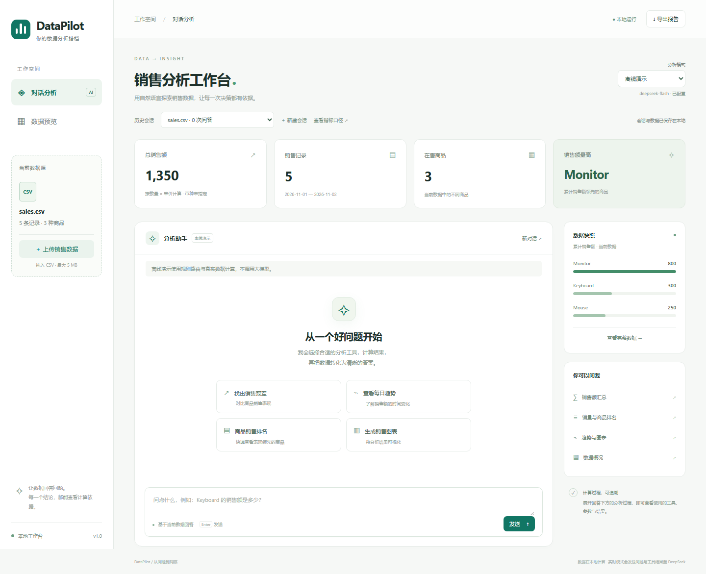

# DataPilot · 销售数据分析 Agent

[English](README_EN.md) · [变更记录](CHANGELOG.md) · [贡献指南](CONTRIBUTING.md) · [v1.1设计](docs/v1.1-plan.md)

用自然语言查询销售数据，查看计算依据，生成图表并导出报告。项目从 CSV / Pandas 练习发展为一个带工具调用、短期对话记忆和质量校验的本地应用。

**v1.1 新增：只读SQL、版本化指标口径、持久会话与历史恢复。** 学习 [DB-GPT](https://github.com/eosphoros-ai/DB-GPT) 的执行分层和 [WrenAI](https://github.com/Canner/WrenAI) 的语义上下文思路，在明确的销售场景中独立实现。项目不包含它们的源码，也不声称拥有完整企业BI能力。



## 快速运行

已有本项目虚拟环境时，在 PyCharm 打开项目，选择 `.venv/Scripts/python.exe`，右键运行 **`app.py`**，浏览器打开 **http://127.0.0.1:8765**。

页面默认是**离线演示模式**：使用规则选择工具，仍由真实 Python 代码计算数据，不消耗模型调用额度。右上角切换到 **DeepSeek 实时分析** 后才会调用模型。切换模式保留当前CSV，并开始新对话。

网页会话默认保存到 `outputs/state.sqlite3`，服务重启后可以从“历史会话”恢复数据、回答与计算依据。“新建会话”保留旧会话并复制当前数据；“新对话”会清空当前会话历史。

全新安装（Windows PowerShell，Python 3.12）：

```powershell
Set-Location "D:\agent ai\DataPilot"
New-Item -ItemType Directory -Path "D:\CodexData\temp" -Force | Out-Null
$env:TEMP = "D:\CodexData\temp"
$env:TMP = "D:\CodexData\temp"
$env:PIP_CACHE_DIR = "D:\CodexData\caches\pip"
python -m venv .venv
.\.venv\Scripts\python.exe -m pip install -r requirements-lock.txt
.\.venv\Scripts\python.exe app.py
```

也可使用 `start_datapilot.ps1`，它为本次运行设置D盘缓存。启动服务后保持该终端运行。端口被占用时，先关闭自己之前启动的实例。

## DeepSeek 配置

保留现有 `.env` 即可；全新安装时把 `.env.example` 复制为 `.env`，填写：

```dotenv
DEEPSEEK_API_KEY=你的密钥
DEEPSEEK_MODEL=deepseek-flash
DEEPSEEK_BASE_URL=https://api.deepseek.com
DEEPSEEK_TIMEOUT=45
```

配置改变后重启服务。密钥只由Python读取，不发送到浏览器；源码包与Git忽略文件均排除 `.env`。模型名和接口遵循 [DeepSeek 官方文档](https://api-docs.deepseek.com/)。实时模式会把问题、必要对话历史和工具结果发给DeepSeek；原始CSV默认不整表发送。

## 可以做什么

| 工具 | 能力 | 示例问题 |
|---|---|---|
| `get_total_sales` | 所有记录的总销售额 | 所有商品的总销售额是多少？ |
| `get_top_product` | 最高商品及并列情况 | 哪个商品销售额最高？ |
| `get_sales_for_product` | 指定商品查询，名称忽略大小写 | Keyboard 的销售额是多少？ |
| `get_sales_by_date` | 每日汇总与含边界日期筛选 | 2026-11-01 到 2026-11-02 的销售额是多少？ |
| `get_product_ranking` | 销售额 / 销量排名，最多50名 | 按销量列出前3名商品 |
| `get_dataset_summary` | 数据量、日期范围和总量 | 数据一共有多少条记录？ |
| `create_sales_chart` | 商品柱状图 / 每日趋势图，下载PNG | 画每日销售趋势图 |
| `get_data_schema` | 当前表字段、类型与含义 | sales表有哪些字段？ |
| `get_business_metrics` | 读取版本化指标定义 | 加权均价的计算口径是什么？ |
| `query_metric` | 按批准的口径进行分组与日期筛选 | 按weighted_unit_price查询加权成交均价 |
| `run_readonly_sql` | 受限SQLite查询，显示SQL和结果表格 | 用只读SQL查询各商品销售额 |

支持上下文追问，例如先问“Keyboard 的销售额是多少？”，再问“那 Mouse 呢？”。复杂问题可在一轮中调用多个工具或分步查询。工具参数通过Pydantic校验，仅执行白名单函数。

界面支持上传CSV、数据预览、工具执行记录、图表下载、商品汇总CSV导出和含问答依据的Markdown报告。切换数据会校验新文件，成功后开始新对话；文件不合格时原数据保留。

指标口径保存在 `semantic/metrics.json`，可在Git中审查、修改和追踪版本。“加权成交均价”是总销售额除以总销量；没有订单ID时，不把销售记录数当成订单数、不把每条记录的平均销售额当成客单价。

只读SQL在独立内存数据库中执行，只能访问当前 `sales` 表。使用SQLite授权回调、函数白名单、参数绑定、1秒执行期限和最多200行返回上限；不能访问会话数据库、附加外部文件或执行写操作。它是受限查询执行器，不是任意代码沙箱。

## CSV 数据约定

```csv
date,product,quantity,unit_price
2026-11-01,Keyboard,2,100
2026-11-01,Mouse,3,50
```

- 必须包含 `date`、`product`、`quantity`、`unit_price`，可以有其他命名列。
- 日期必须为有效的 `YYYY-MM-DD`；商品名非空，最多120字符。
- 数量是非负整数，单价是有限非负数；必要字段不允许空值。
- UTF-8 / UTF-8 BOM / GB18030；最多5 MB、50,000行；重复表头和行宽错误会被拒绝。
- `sales_amount` 始终根据数量与单价重算；汇总显示保留两位小数。币种未指定，不推断税费、退货或汇率。
- 日期统计最多返回366个有记录日期；图表显示前20名商品或最近366个有记录日期。大规模并列仅返回前20个名称及总数，不假装是完整清单。

## 代码结构

```text
app.py                  网页入口，PyCharm直接运行
api_test.py             兼容入口，启动命令行Agent
main.py                 纯Python分析与绘图示例，不调用模型
sales_tools.py          保留早期练习函数的兼容接口
datapilot/
  config.py             配置、密钥与项目路径
  data.py               CSV读取和质量校验
  tools.py              11个工具、参数契约和分发
  sql.py                只读SQL执行与资源限制
  semantic.py           指标契约与受控指标查询
  store.py              SQLite持久会话与恢复
  models.py             DeepSeek客户端、超时与有界重试
  demo.py               明确标注的离线规则演示
  agent.py              工具循环、历史与完整上下文预算
  reports.py            Markdown和CSV导出
  web.py                会话、上传、聊天与文件下载API
  cli.py                连续命令行问答
static/                 HTML/CSS/JavaScript本地界面，无前端构建步骤
semantic/               版本化业务指标定义
tests/                  自动化回归测试
evals/                  26题固定功能评测与同模型基线对照
docs/                   架构、学习路线、评测与演示说明
outputs/                运行产物（Git忽略，保留在本地）
```

从其他工作目录启动也能找到项目默认CSV和 `.env`，所有路径以项目目录为基准。命令行：

```powershell
.\.venv\Scripts\python.exe api_test.py --demo
.\.venv\Scripts\python.exe api_test.py
.\.venv\Scripts\python.exe api_test.py --csv "D:\你的数据\sales.csv"
```

## 测试和评测

```powershell
# 不调用模型，覆盖真实数据计算、异常、工具流程与HTTP API
.\.venv\Scripts\python.exe -m unittest discover -v

# 26题规则演示回归，不消耗模型额度
.\.venv\Scripts\python.exe -m evals.run_eval --mode demo

# 26题真实DeepSeek评测，并运行24题单次生成基线（会调用API）
.\.venv\Scripts\python.exe -m evals.run_eval --mode live --baseline

# 新增SQL与指标题集，调用真实模型
.\.venv\Scripts\python.exe -m evals.run_eval --mode live --cases evals/sql_cases.json

# 1千、1万、5万行合成数据的读取与SQL聚合校验，不调用模型
.\.venv\Scripts\python.exe -m evals.benchmark_data
```

逐题结果、Token、耗时和报告写入 `outputs/evaluations/`。实际运行数据见 [评测报告](docs/evaluation.md)，评测边界与基线条件也在报告中说明。演示模式的通过率不代表模型准确率；这组固定小数据回归也不代表真实业务泛化。

## 运行边界

这是单用户本地作品，默认仅监听 `127.0.0.1`，不作为公网多租户服务。网页数据与对话保存在本地SQLite，缓存最多32个活跃会话；更换数据或模式重开当前对话。命令行会话仍为进程内存。模型保留最近6个完整轮次，并把每次消息上下文限制在24,000字符，超限时先移除旧轮次，再给出可解释的范围提示。

每轮最多4轮工具选择、8次工具执行，最后一轮仅生成回答；每个模型步骤最多2次HTTP尝试，默认单次超时45秒。失败不提交不完整历史。Token来自服务返回值；可在 `.env` 填写每百万Token单价估算费用，实际账单以服务商为准。

## 展示与面试

- [架构与请求流程](docs/architecture.md)
- [按模块理解代码](docs/learning-guide.md)
- [评测结果与指标边界](docs/evaluation.md)
- [演示脚本与简历描述](docs/demo-and-resume.md)

## Docker与CI

安装Docker后，在项目目录准备本地 `.env`，运行 `docker compose up --build`，浏览器打开同一地址。命名卷保存会话和产物，端口只绑定宿主机回环地址。镜像以非root用户运行，并提供健康检查。

GitHub Actions运行无密钥单元/集成测试、离线评测和容器冒烟测试；真实模型评测保留为本地显式命令。Actions依赖固定到已核对的提交SHA。

当前仓库按所有者要求保持私有，后续公开另行决定。原练习文件备份保留在 `D:\CodexData\temp\DataPilot-original-20261104-151046`，本地 `.env` 保留且不提交。参见 [v1.1设计与来源](docs/v1.1-plan.md)。
