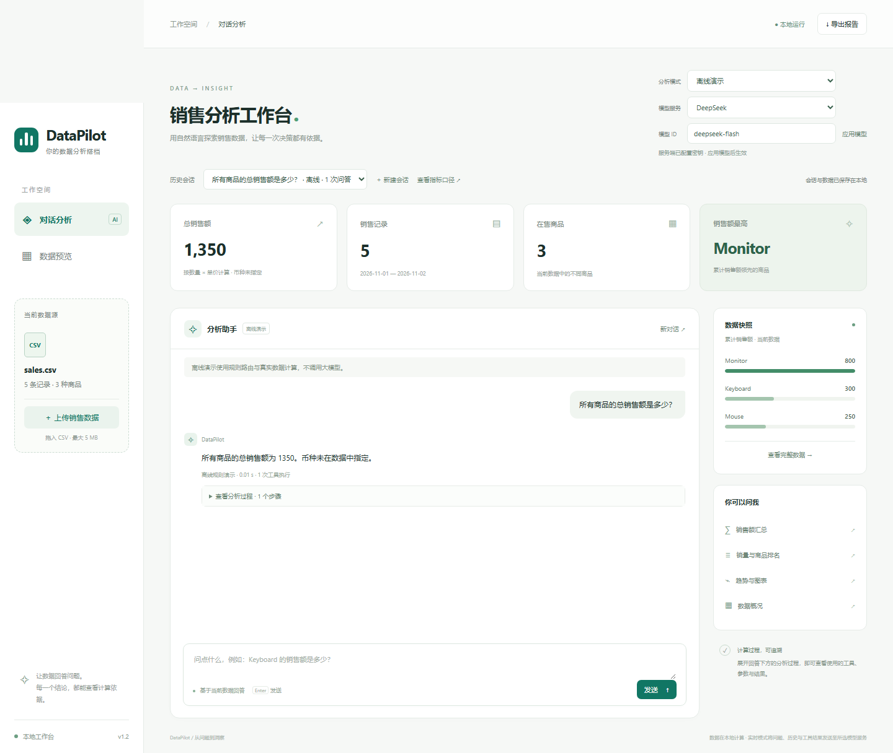

# DataPilot

**Upload a sales CSV. Ask questions. Check the evidence behind the answers.**

DataPilot is a local sales analytics agent built with Python. Explore sales totals, product rankings and date ranges, or generate trend charts. Expand the analysis trace to inspect tool arguments, computed results, and SQL statements with their result tables.

[Quick start](#run) · [Try three examples](#three-reproducible-examples) · [Configure models](docs/models.md) · [中文文档](README.md)

- **Try it before connecting a model.** The offline rules demo needs no API key. Live mode supports DeepSeek, OpenAI/Codex, Claude and OpenAI-compatible services.
- **Inspect the evidence.** Eleven schema-validated tools, versioned metric definitions and restricted read-only SQL help you verify where numbers come from.
- **Complete an analysis workflow.** Upload CSVs, ask follow-up questions, restore past sessions and export Markdown reports, summary CSVs and PNG charts.



In the weekly retail example below, the revenue leader is **显示器 (monitor), 9000**, while the unit-sales leader is **无线鼠标 (wireless mouse), 60 units**. Inspect the results, generate a chart and download your analysis.

The app starts in offline rules demo mode; connect a model for live agent analysis. It is designed for single-user local use with a fixed sales CSV schema. The interface and example prompts are in Chinese.

## Three reproducible examples

All examples use synthetic CSV data and six copyable Chinese prompts each. They work in the offline rules demo without an API key; these checks do not establish live model accuracy.

| Example | What it demonstrates | Walkthrough |
|---|---|---|
| Weekly retail review | Sales total 16000; revenue and unit rankings differ | [Data and steps](docs/cases/retail_weekly.md) |
| Promotion review | Equal-length date windows; weighted unit price 85.88; daily chart | [Data and steps](docs/cases/promotion_review.md) |
| Data boundaries | Distinct 00123/123 IDs, ties, missing dates, recorded zeros and SQL evidence | [Data and steps](docs/cases/data_boundaries.md) |

Download CSVs from the [example directory](examples/README.md), create a new session for each, then upload its file. Walkthroughs and UI prompts are in Chinese. Keep original CSVs intact; spreadsheet software may strip leading zeros if you open and resave them.

## What is implemented

- Eleven schema-validated tools covering sales totals, products, dates, rankings, charts, schema discovery, business metrics and read-only SQL.
- Versioned metric definitions in `semantic/metrics.json`; weighted price is explicitly different from the simple average of prices.
- A bounded multi-step tool loop, complete-turn context management, error recovery and request telemetry.
- SQLite-backed web sessions with dataset, conversation and evidence restoration across restarts.
- A local web UI with CSV upload, history selection, SQL/result inspection, metric definitions, Markdown/CSV/PNG export and an explicitly labeled offline rules demo.
- Automated tests, fixed evaluation datasets, a data-size benchmark and Docker/CI configuration.

The design learns from DB-GPT's execution layering and WrenAI's semantic-context approach. It is independently implemented for a narrow sales-data use case, not a reimplementation of either platform.

## Run

Install Git and **Python 3.12.x** first. Node.js and frontend build tools are not required. The repository is currently private: cloning requires an authorized GitHub account. If you already have the source, open its root directory (containing `app.py`) and skip cloning.

**Windows PowerShell** — check `python --version` is 3.12.x. If needed, use `py -3.12` to create the environment:

```powershell
git clone https://github.com/lihuipenf/DataPilot.git
Set-Location DataPilot
python -m venv .venv
.\.venv\Scripts\python.exe -m pip install -r requirements-lock.txt
$env:MPLCONFIGDIR = Join-Path (Get-Location).Path ".cache\matplotlib"
.\.venv\Scripts\python.exe app.py
```

The cache setting works on machines without a D: drive. Virtual environment activation and changes to PowerShell execution policy are unnecessary.

**macOS / Linux** — use Python 3.12:

```bash
git clone https://github.com/lihuipenf/DataPilot.git
cd DataPilot
python3.12 -m venv .venv
.venv/bin/python -m pip install -r requirements-lock.txt
.venv/bin/python app.py
```

If only `python3` is available, confirm it is 3.12 before using it to create the environment. Some Linux distributions require the matching venv package. Install a supported CJK font such as Noto Sans CJK SC if chart labels show missing glyphs; the Docker image includes CJK fonts.

Open **http://127.0.0.1:8765** and keep the terminal running. Offline rules demo is the default: **no `.env` or API key is needed for native startup**. Dependency installation needs internet access; demo questions do not call a model. Ask `所有商品的总销售额是多少？` and expect **1350**, then inspect the tool evidence. The default dataset has five rows and three products. Stop the native server with `Ctrl+C`.

Sessions are stored under `outputs/`, excluded from Git. Reuse the same directory to restore history after a restart. The health endpoint is `/api/health`; `/openapi.json` provides the API schema, while interactive `/docs` and `/redoc` are disabled.

To use a real model, create `.env` **only if it does not exist**:

```powershell
# Windows PowerShell
if (-not (Test-Path -LiteralPath .env)) { Copy-Item .env.example .env }
```

```bash
# macOS / Linux
if [ ! -f .env ]; then cp .env.example .env; fi
```

Edit the desired provider's API key and model ID, then restart the server. Existing DeepSeek configuration remains valid. See [provider configuration](docs/models.md). Keep keys local; live requests may incur API costs.

Choose provider and model ID in the UI, then select **大模型实时分析** (live model analysis) in the mode dropdown. Clicking Apply while the mode is still offline demo continues to use rules. Switching creates a new session that copies the dataset and preserves the old conversation. Provider and model provenance survive restarts. OpenAI access uses an API key with model permission; Codex desktop login credentials are not used. Only network protocol tests are available for providers without local credentials; do not interpret these as live model evaluations.

Optional checks, shown for macOS/Linux (Windows uses `.\.venv\Scripts\python.exe`):

```bash
.venv/bin/python -m pip check
.venv/bin/python -m unittest discover -v
.venv/bin/python -m evals.run_eval --mode demo
```

## Docker Compose

Install and start Docker, check `docker compose version`, and create the local `.env` with the guarded copy command above. Compose requires this file even for the offline demo; keys may remain empty. Host Python is not required.

```bash
docker compose up --build -d
docker compose ps
docker compose logs -f datapilot
```

Open the same local URL. `Ctrl+C` exits log following without stopping the container. To stop, run `docker compose down` without `-v` to retain the named volume. Docker state is separate from native `outputs/`; changing the Compose project name/location can select a different volume. After editing `.env`, run `docker compose up -d --force-recreate`; after source updates, run `docker compose up --build -d`.

## Troubleshooting and updates

- **Missing packages:** install with the same virtual environment interpreter used to run `app.py`. In PyCharm select that interpreter explicitly.
- **Port 8765 already in use:** stop your earlier native/container instance, or run `.venv/bin/python -m uvicorn app:app --host 127.0.0.1 --port 8766` (Windows: replace the interpreter path), then open port 8766.
- **Repository not found:** private repository access requires an authorized GitHub account.
- **Missing `.env`:** native demo does not need it; Compose does. Use the guarded copy command to preserve existing credentials.
- **Unexpected model configuration:** process environment variables override `.env`; restart native services or recreate containers after changes.
- **Updating:** stop native services and back up the full `outputs/` directory and local `.env`. Save source edits before `git pull --ff-only`, reinstall locked dependencies, then restart. Do not overwrite `.env` with the example. Container data lives in its named volume.

The [detailed setup guide](docs/getting-started.md) covers first-run checks, PyCharm, data locations, and common failures. Windows native setup and Linux container startup are verified separately; macOS native commands require testing on that platform.

## Boundaries and evidence

See the [v1.3 hardening record](docs/security-hardening-v1.3.md) for the audit dispositions. Remote model endpoints require HTTPS; plain HTTP is restricted to loopback addresses. HTTP clients ignore proxy/CA environment settings by default; explicitly set `DATAPILOT_TRUST_ENV=true` for a trusted enterprise proxy or custom CA.

This is a single-user local project, not a public multi-tenant service. SQL uses a separate in-memory `sales` table, an authorizer and function allowlist, row/time limits and no external-file access. This is not an arbitrary-code sandbox. Data must follow the documented sales CSV contract; currency and independent order identity are not inferred.

There is no user authentication. Other local processes can access the API. Use `-p 127.0.0.1:8765:8765` for manual Docker publishing; the container must still listen on `0.0.0.0` internally. Shared-host or external deployment requires an authenticated gateway. The mode API now returns a new session ID and preserves the old session.

Defaults: 200 saved sessions, 100 charts per session, 256 MiB of PNGs across the output directory. Limits reject new writes without deleting existing data. Model messages and tool schemas share a 24,000-character budget; tool output is capped at 8,000 characters with complete-row truncation. A cooperative 120-second turn budget and Stop button prevent further steps or history commits after cancellation. They do not forcibly interrupt an in-flight synchronous request, lock wait, or trickling response.

CSV uploads allow at most 64 columns; only the four required business columns are parsed by Pandas. SQL checks fields as rows are fetched, with a 256 KiB UTF-8 JSON budget for result rows and column names. Exported reports show questions and model answers in literal code blocks and escape other untrusted text, preventing it from becoming HTML or external images. Nonempty API bodies must use a JSON media type, except for raw CSV uploads.

See [evaluation records](docs/evaluation.md) for actual results and limitations. Offline rules scores, unit tests and live model evaluation are different forms of evidence. Small fixed-dataset results do not establish production accuracy. Model requests in live mode send questions, necessary history and tool evidence to the configured provider.

The repository is private during development. Runtime datasets, state databases, keys, virtual environments and generated output directories are excluded from version control.
