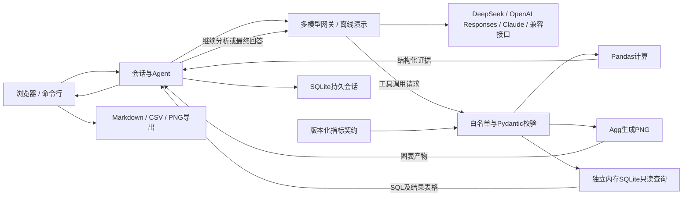

# 架构与一次请求的生命周期

1. 浏览器发送问题和会话ID。服务器取得会话锁，防止同一会话同时改数据和聊天。
2. Agent将系统规则、最近的完整历史轮次和本轮问题组成请求，检查完整字符预算。
3. 模型返回文本或带ID的工具调用。工具描述由Pydantic参数模型生成，避免说明与校验规则分离。
4. 注册表只按白名单分发，解析JSON并验证类型、必填项、范围和额外参数。Python内部绑定当前DataFrame，模型无需传入文件路径。
5. 工具返回实际计算结果或结构化错误；Agent把结果与tool_call_id关联后继续请求模型。
6. 模型可以再次选工具。到达轮次或调用次数上限时禁用工具，只允许最后回答。
7. 获得完整回答后提交本轮历史，并返回工具记录、产物、Token和耗时。失败时本轮不提交，原会话仍可继续。

## 边界设计

**数据层**严格校验结构，防止pandas隐式索引吞掉多余字段；重新计算销售额，不信任上传的派生值。商品名称是数据，不能变成Python代码或HTML。

**模型层**统一屏蔽密钥和底层异常详情。超时、网络、限流及服务端错误最多重试一次；鉴权错误不重试。模型步骤数是Agent逻辑步骤，不等于HTTP尝试次数。

v1.2通过 `create_gateway` 选择原生协议，统一返回 `ModelReply`。OpenAI续传完整输出项（含推理信息和phase），Claude续传原生内容块并合并并行工具结果；HTTP200但格式无效也返回受控错误。服务商与模型绑定到会话，只有服务端读取凭据，配置详见 [多模型指南](models.md)。

**上下文层**按完整轮次移除旧消息，避免留下孤立的tool消息。检查范围包含本轮工具结果；超大并列清单会明确给出截断标记与总数量。若本轮仍超预算，要求缩小查询范围，不静默丢弃证据。

**界面层**不保存密钥。通过textContent等安全DOM接口显示用户输入和模型文字；图表仅来自当前会话生成的合法PNG名称。网页切换模式或应用模型时复制数据并新建会话，原会话仍可恢复；坏CSV替换是原子的。

**存储层**在v1.1中使用SQLite持久会话，保存数据、完整轮次、问答与执行证据；服务重启后按会话ID恢复。缓存最多32个活跃会话，旧状态保留在数据库。保存失败时不提交新的对话状态。命令行仍使用内存会话。多人部署仍需要身份认证、独立任务队列和跨进程会话协调。

**语义层**读取 `semantic/metrics.json`。定义版本、表达式、单位与数据假设进入Git审查；`query_metric`只允许已知指标、product/date维度和绑定的日期参数。均价采用加权口径；数据缺少订单ID，不能声称计算真实客单价。

**SQL层**将当前数据装载到独立内存库，不暴露持久会话数据库。SQLite授权回调拒绝写操作、系统表、外部附加库和未授权函数；执行单条语句，限制SQL长度、结果行数、字段长度和运行期限。错误以结构化信息返回模型，允许有界修正。SQL工具不是任意代码执行器。

## 关键取舍

- 使用直接工具循环，便于学习和追踪每条消息；没有为了简历堆叠多个编排框架。
- 模型负责选择与解释，Pandas负责数值；离线演示规则和真实模型实现相同网关接口，但明确区分指标。
- 使用无窗口的Matplotlib Figure/Agg生成图表，避免Web线程调用GUI绘图。
- 基线比较采用同模型、同数据、同组对话和同输出上限，一次生成不提供工具；输出校验边界在评测文档公开。
