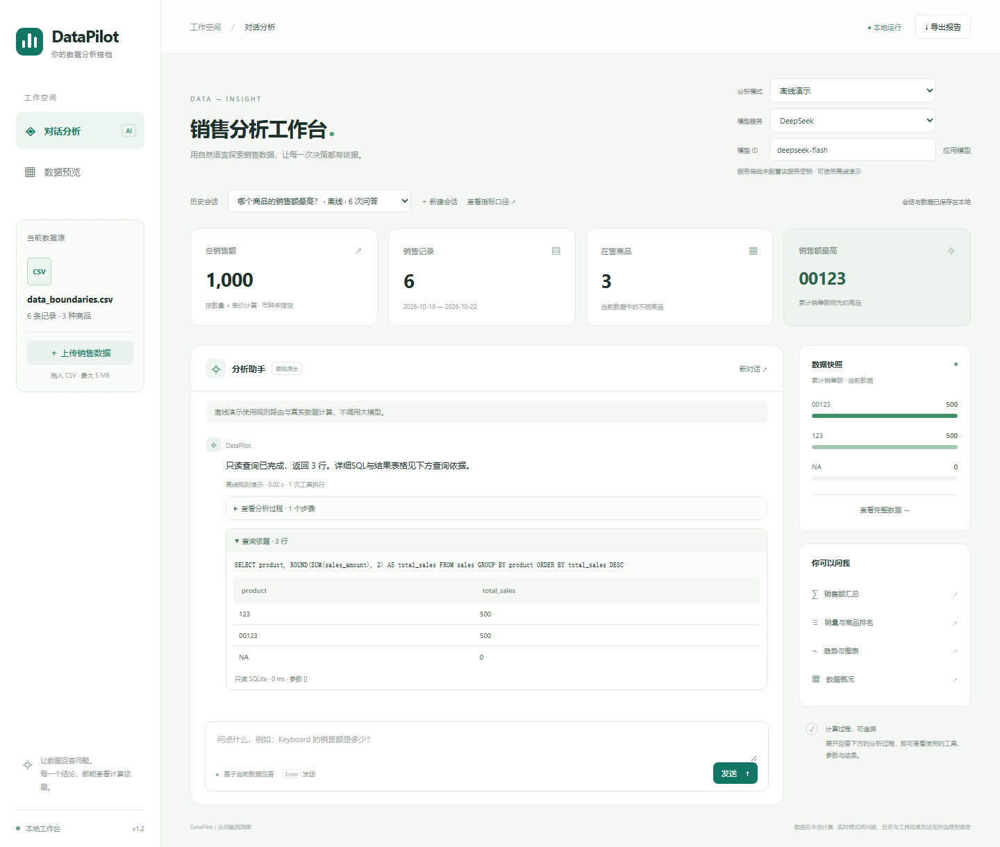

# 案例三：编号、并列冠军和没有记录的日期

[案例目录](../../examples/README.md) · [下载CSV](../../examples/data_boundaries.csv)

## 业务背景

虚构销售表使用 `00123`、`123`、`NA` 作为三个不同商品编号。这组数据专门演示标识符保留、并列结果和缺失数据的解释。它是人工构造的边界案例，共6条记录、16件、总销售额1000，金额币种未指定。

| 商品编号 | 总销量 | 总销售额 | 数据含义 |
|---|---:|---:|---|
| 00123 | 5 | 500 | 前导零属于编号 |
| 123 | 10 | 500 | 与00123不同的商品 |
| NA | 1 | 0 | 字面名称，既有数量0的记录，也有数量1、单价0的记录 |

2026-10-20没有记录。2026-10-22有一条销售记录，数量1、单价0，因此已记录销售额为0。

## 操作顺序

直接上传下载到的原始 `data_boundaries.csv`，避免先用Excel打开并另存导致前导零丢失。新建会话上传后，先在“数据预览”确认 `00123`、`123`、`NA` 都存在，再提问：

| 可复制问题 | 预期结果 | 计算依据 |
|---|---|---|
| 哪个商品的销售额最高？ | 00123与123并列，均为500 | `get_top_product`，tied_count为2 |
| 00123 的销售额是多少？ | 保留编号00123，销售额500 | `get_sales_for_product` |
| 2026-10-20 当天的销售额是多少？ | 没有销售记录，当前筛选汇总为0 | daily_sales为空列表 |
| 2026-10-22 当天的销售额是多少？ | 有10-22这一日期，已记录销售额为0 | daily_sales包含一行0值 |
| Phone 的销售额是多少？ | 未找到Phone，不能提供其销售额 | product_not_found |
| 用只读SQL查询各商品销售额 | 返回三个编号及500、500、0 | `run_readonly_sql`，结果不截断 |

离线模式的SQL题执行固定只读示例：

```sql
SELECT product, ROUND(SUM(sales_amount), 2) AS total_sales
FROM sales
GROUP BY product
ORDER BY total_sales DESC
```

两个500并列，SQL未约定它们的内部顺序；验收按商品编号核对，不依赖哪一个排在第一行。

顶部“销售额最高”卡片显示其中一个代表商品；完整并列名单请在问答及 `tied_products` 工具结果中核对。

## 应当解释清楚的区别

没有某日记录，仅表示当前文件缺少该日证据，不能断言真实业务当天没有销售。有零值记录表示文件明确记录了该行，含义不同。未知商品应返回未找到，不能编造为0。

数量为0、单价为0在当前数据契约中合法。这组记录没有订单ID，不应将6条记录说成6个订单；商品NA也不应被解析为缺失值。

## 60秒讲解

先在数据预览展示两个不同编号，再展示并列冠军。随后对比10月20日和22日的工具结果，查询不存在的Phone，最后打开SQL依据表格，确认三个商品均保留。


