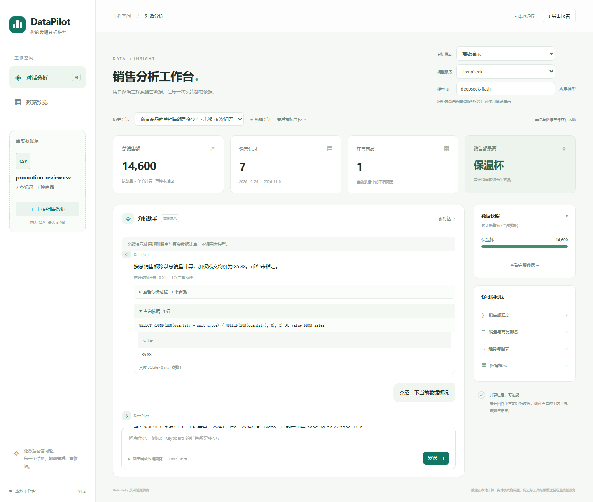

# 案例二：促销区间与加权成交均价

[案例目录](../../examples/README.md) · [下载CSV](../../examples/promotion_review.csv)

## 业务背景

虚构商店为保温杯安排三天优惠，之后恢复原价。分析者需要先核对相同长度的区间，再计算整段数据的加权成交均价。所有记录为合成数据，金额币种未指定。

数据范围为2026-10-26至2026-11-01，共7条记录、170件、总销售额14600。

| 阶段 | 日期 | 单价 | 销量 | 销售额 |
|---|---|---:|---:|---:|
| 活动前，3天 | 10-26至10-28 | 100 | 30 | 3000 |
| 活动期间，3天 | 10-29至10-31 | 80 | 120 | 9600 |
| 恢复原价，1天 | 11-01 | 100 | 20 | 2000 |

最后一天计入全表总额与均价，但不混入两段各3天的对比。

## 操作顺序

在网页保持“离线演示”，新建会话并上传 `promotion_review.csv`，逐条提问：

| 可复制问题 | 预期结果 | 计算依据 |
|---|---|---|
| 所有商品的总销售额是多少？ | 14600 | `get_total_sales` |
| 2026-10-26到2026-10-28的销售额是多少？ | 每天1000，区间3000 | `get_sales_by_date`，包含起止日期 |
| 2026-10-29到2026-10-31的销售额是多少？ | 每天3200，区间9600 | `get_sales_by_date`，包含起止日期 |
| 全部记录的加权成交均价是多少？ | 85.88 | `query_metric`，weighted_unit_price |
| 介绍一下当前数据概况 | 7条、1种商品、170件、14600 | `get_dataset_summary` |
| 画每日销售趋势图 | 7个日期的趋势图，可下载 | `create_sales_chart`，kind为daily |

## 核对口径

全表加权成交均价为 `14600 ÷ 170 = 85.88`，按项目指标保留两位小数。单价列的简单平均为 `(100+100+100+80+80+80+100) ÷ 7 = 91.43`；后者没有体现每条记录的销量。

两个等长区间的销售额从3000变为9600，变化为 `(9600-3000) ÷ 3000 = 220%`；销量从30变为120，变化为300%。这些比例是文档根据核对值计算的，离线演示分别返回区间结果，不自动完成整段业务复盘。

销售记录能展示期间差异，不能证明促销导致了全部增长。没有成本和活动费用，不能计算利润或ROI；没有独立订单ID，加权单价也不能写成客单价。

## 60秒讲解

分别查询活动前和活动期间的等长区间，再问加权成交均价，展示实际SQL和结果85.88。最后生成每日趋势图，说明11月1日恢复原价的记录仍保留在全表统计中。

