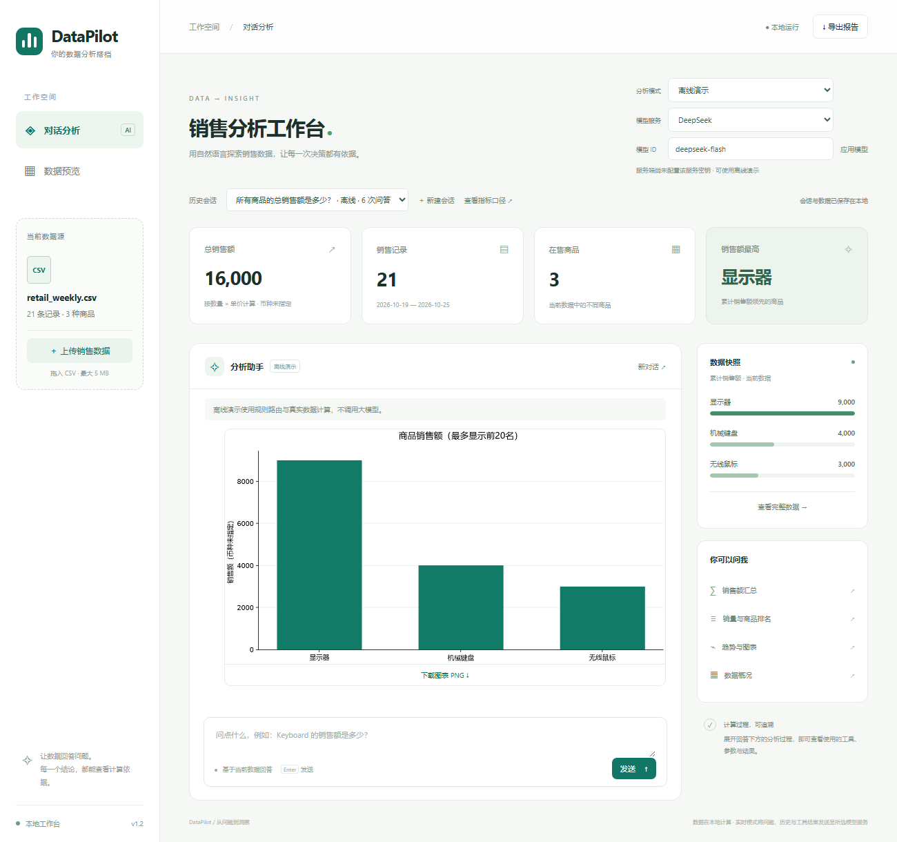

# 案例一：电商一周销售复盘

[案例目录](../../examples/README.md) · [下载CSV](../../examples/retail_weekly.csv)

## 业务背景

一家虚构数码商店销售机械键盘、无线鼠标和显示器。负责人希望知道一周卖了多少、哪类商品贡献销售额、哪类商品销量最多，并查看每天的变化。数据为合成记录，金额币种未指定。

日期为2026-10-19至2026-10-25，共21条记录、3种商品、90件，总销售额16000。

## 操作顺序

在网页保持“离线演示”，新建会话并上传 `retail_weekly.csv`。概况卡片应显示16000、21条记录、3种商品、销售额最高为显示器，然后按顺序提问：

| 可复制问题 | 预期结果 | 计算依据 |
|---|---|---|
| 所有商品的总销售额是多少？ | 16000 | `get_total_sales` |
| 哪个商品的销售额最高？ | 显示器，9000 | `get_top_product` |
| 按销量列出商品排名前3名 | 无线鼠标60、机械键盘20、显示器10 | `get_product_ranking`，metric为quantity |
| 按销售额列出商品排名前3名 | 显示器9000、机械键盘4000、无线鼠标3000 | `get_product_ranking`，metric为sales_amount |
| 按日期统计每天的销售额 | 见下表，总计16000 | `get_sales_by_date` |
| 画商品销售额柱状图 | 3个商品，图表可下载 | `create_sales_chart`，kind为product |

| 日期 | 销售额 |
|---|---:|
| 2026-10-19 | 1600 |
| 2026-10-20 | 2800 |
| 2026-10-21 | 1650 |
| 2026-10-22 | 2150 |
| 2026-10-23 | 2800 |
| 2026-10-24 | 2400 |
| 2026-10-25 | 2600 |

## 应当得到的结论

显示器10件、单价900，对应9000销售额，占总额56.25%；无线鼠标60件、单价50，对应3000销售额，占总额18.75%。销量最多和销售额最高是不同商品。10月20日与23日的销售额并列最高，均为2800。

以上占比由已核对金额直接计算，离线问题列表不自动输出这些派生占比。数据没有成本、库存或订单ID，不能据此声称利润最高、需要补货多少或共有多少订单。

## 60秒讲解

先展示上传后的16000总额，再依次打开销量和销售额排名。强调两套排名的差别，最后生成柱状图、展开计算依据并导出报告。演示时说明数值由本地工具计算，当前使用离线规则选择工具。

